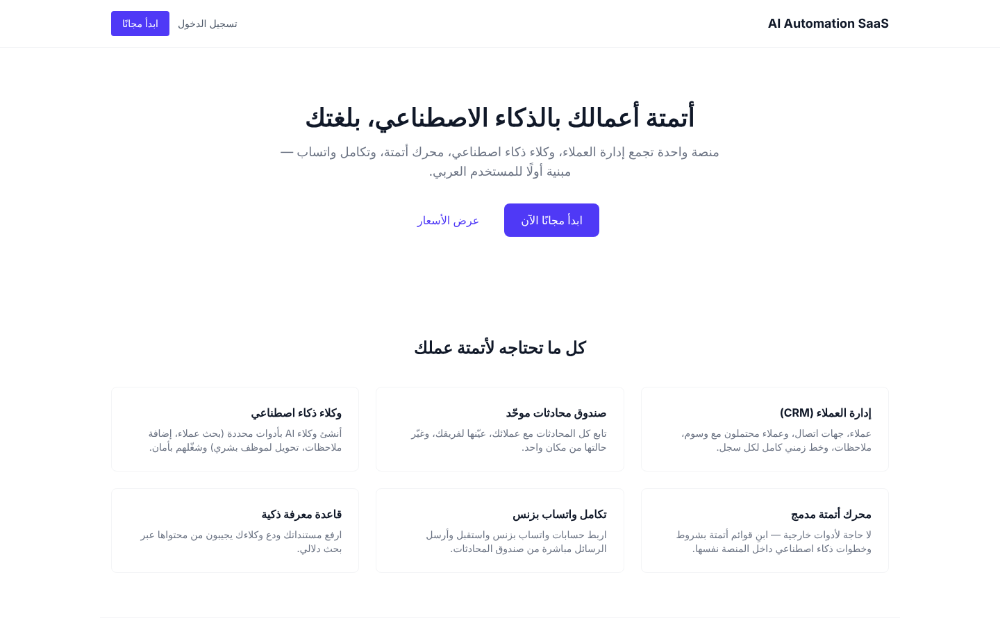
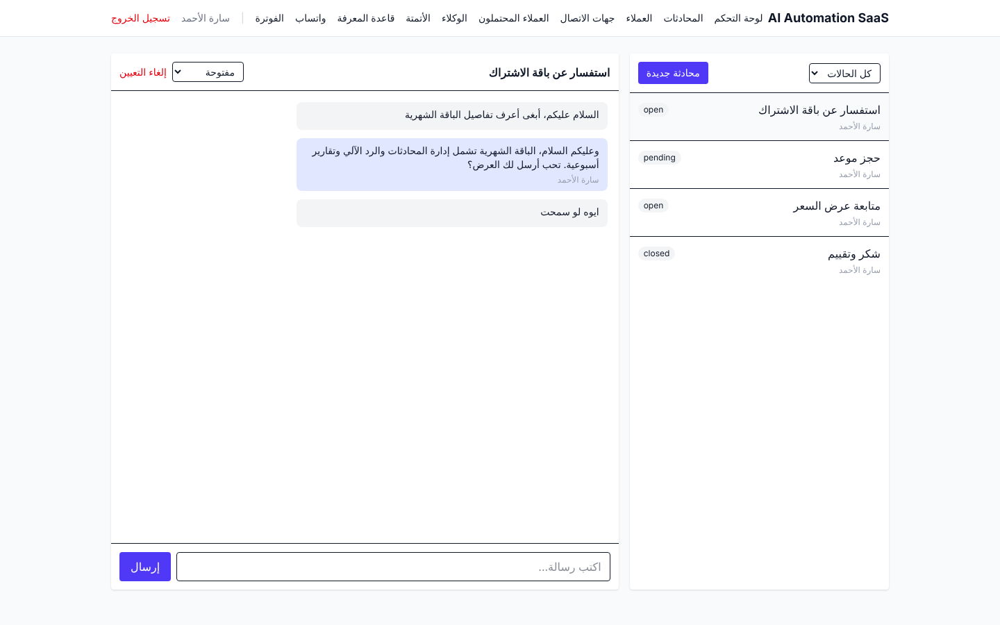
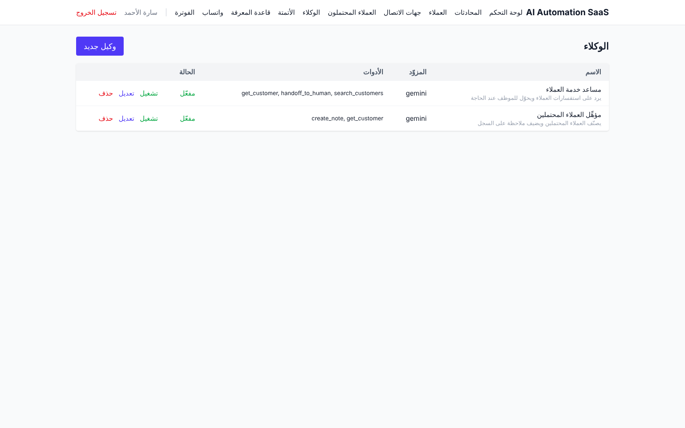
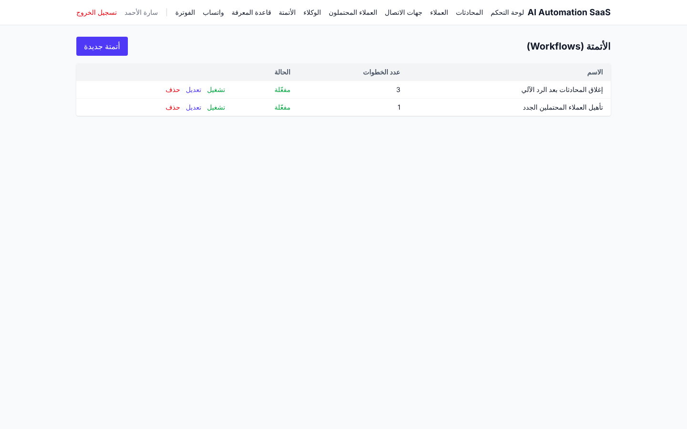
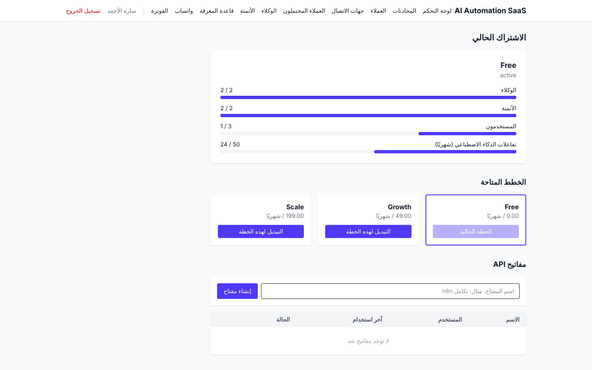
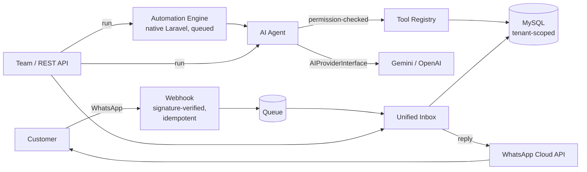

# AI Automation SaaS

**An Arabic-first, multi-tenant platform that combines a CRM, a unified customer inbox, AI agents, a native automation engine, and WhatsApp Business in one Laravel application.**

> This is a showcase repository. The source code is private and is available for review on request during technical interviews.

---

## The problem

Small and mid-sized businesses in the Arab world usually juggle a separate CRM, a WhatsApp inbox, a chatbot tool, and an automation tool such as n8n or Zapier. Each one has its own data, its own login, and its own bill, and few of them treat Arabic and RTL as first-class.

## The solution

One multi-tenant platform where a company can:

- **Manage customers**: customers, contacts, leads, tags, notes, and a full activity timeline per record.
- **Handle every conversation in one inbox**: assign conversations, change their status, and reply, with WhatsApp messages flowing into the same inbox.
- **Run AI agents**: each agent has its own system prompt and provider (Gemini or OpenAI), and may call only the tools it has been explicitly granted.
- **Automate workflows natively**: queued workflows of condition, status, and AI-agent steps, with no external orchestrator.
- **Ground answers in its own documents**: a knowledge base with asynchronous extraction, chunking, embeddings, and similarity search.
- **Operate as a SaaS**: plans, subscriptions, usage limits, API keys, and a versioned REST API.

---

## Screenshots

| Unified inbox (WhatsApp channel) | AI agents with per-agent tool permissions |
|---|---|
|  |  |

| Automation workflows | Subscription, usage limits and API keys |
|---|---|
|  |  |

Screenshots use fictional demo data.

---

## Architecture

**Key design decisions**

| Decision | Why |
|---|---|
| **Automation runs inside Laravel, with no n8n or Zapier** | Business rules, authorization and tenant isolation stay in one place. Nothing is handed off to a system that sits outside those guarantees. |
| **Tenant isolation is enforced at the query layer** | A `BelongsToTenant` global scope filters every tenant-owned model server-side. The UI and client-supplied IDs are never trusted. |
| **AI providers sit behind one interface** | Adding a provider means one class plus one config entry, with no change to calling code. |
| **Provider-agnostic tool calling** | Tool calls use a plain JSON convention instead of each vendor's function-calling API, so they work with any text model. The system prompt's tool list is not the security boundary: every call is re-checked server-side against the agent's grants. |
| **AI safety rules** | AI can never run SQL or shell commands, read secrets, or call unregistered tools. Every call is logged with its tokens, duration and status. |
| **Usage limits are enforced before the provider is called** | A blocked request costs nothing and does not count toward the quota. |

---

## Security

- Query-level multi-tenant isolation
- Role-based access control (Spatie Permission, team-scoped)
- WhatsApp webhook signature verification, replay protection and idempotency
- Rate limiting, trusted proxies and security response headers
- Secrets only in environment variables; provider errors never echo keys or raw responses

## Quality

- **266 automated tests (600 assertions), all passing**: unit, feature, tenant-isolation and end-to-end flows.
- Built in **18 documented phases**, each with a written report covering what was built, why, and the known limitations.
- Versioned JSON API (`/api/v1`, Sanctum-authenticated) with 75 endpoints.

## Tech stack

**Backend:** PHP 8.2+, Laravel 12, MySQL, queues, Sanctum, Spatie Permission
**Frontend:** Blade, Alpine.js, Tailwind CSS, Vite, Arabic RTL
**AI:** Gemini and OpenAI through a provider abstraction
**Integrations:** WhatsApp Business Cloud API

---

## Scope and known limitations

This list is kept honest on purpose:

- Workflows are currently triggered manually or through the API, and run as a linear sequence. Event-based triggers are designed for, since the schema already supports them, but are not wired yet.
- The default embedding provider is a local, deterministic baseline. A semantic provider plugs in through `EmbeddingProviderInterface`.
- WhatsApp supports text messages only for now.
- Billing tracks plans and usage. No payment gateway is integrated yet.

---

## Author

**Abdullah Alhakami**: Full Stack Developer and IT Consultant, 25+ years, 85+ delivered systems
.NET/C#, PHP/Laravel, Python, Flutter, Vue.js, n8n, Linux

[LinkedIn](https://www.linkedin.com/in/abdullah-hakkami-746276166) · Source code available on request.
